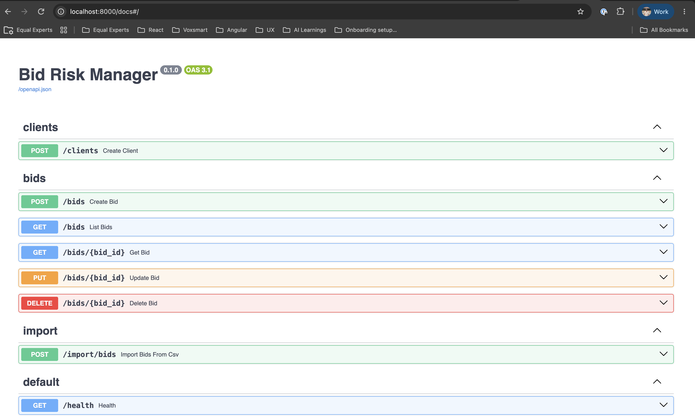
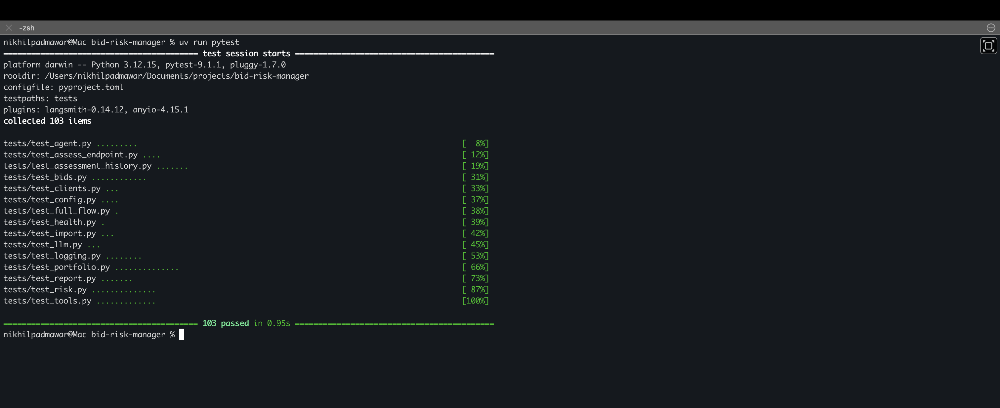

# Bid Risk Manager

A FastAPI service for tracking client bids and finding out which ones are risky. Phase 1 is a complete CRUD API with a database, CSV import, validation, logging, tests and Docker. Phase 2 adds an AI agent that assesses each bid, explains the risk, keeps a history and ranks the riskiest open bids.

## Problem

Our team bids on many client proposals, but bid details (value, cost, deadline, client history) are scattered across spreadsheets and documents, so nobody can say which bids are risky. This service gives bids one home and a clean API, and an agent that checks each bid and says how risky it is and why.

## What it includes

**Phase 1: the foundation**
- CRUD API for clients and bids (create, list with filters, view, update, delete)
- Bulk import of bids from a CSV file, with bad rows skipped and reported
- Request validation and one consistent JSON error format
- Request logging to console and file

**Phase 2: the agent**
- A plain rule-based risk score, used as a baseline
- An AI agent that looks up the bid, client history, margin and deadline with tools, then submits a structured risk report
- Every assessment saved, so a bid's risk can be tracked over time
- Every agent step and tool call logged (the API key is never logged)
- A portfolio summary of the riskiest open bids
- Over 100 automated tests, none of which call a real AI model

## Tech stack

Python 3.12, FastAPI, Pydantic, SQLAlchemy, SQLite, LangChain, OpenRouter, uv, pytest, Docker.

## Quick start (local)

Prerequisite: [uv](https://docs.astral.sh/uv/) installed. uv downloads the right Python version for you.

```bash
git clone https://github.com/NikhilPadmawar/bid-risk-manager.git
cd bid-risk-manager
uv sync
cp .env.example .env
```

Put your [OpenRouter](https://openrouter.ai) API key in `.env` as `OPENROUTER_API_KEY`. Everything except the assessment endpoints works without it. Then start the server:

```bash
uv run uvicorn app.main:app --reload
```

Open http://localhost:8000/docs for the interactive API page (Swagger UI), where every endpoint can be tried from the browser. Tables are created automatically on startup in a local `bids.db` file.

To load the 16 sample bids, call `POST /import/bids` on that page.

## Configuration

Settings are read from environment variables or a `.env` file (copy `.env.example`). Restart the server after changing `.env`.

| Variable | Default | Purpose |
| --- | --- | --- |
| `APP_NAME` | Bid Risk Manager | Title shown in the API docs |
| `DATABASE_URL` | `sqlite:///./bids.db` | Database location |
| `LOG_LEVEL` | `INFO` | `DEBUG`, `INFO`, `WARNING` or `ERROR` |
| `LOG_FILE` | `app.log` | Where logs are written |
| `BIDS_CSV_PATH` | `data/bids.csv` | File used by the CSV import |
| `RISK_MARGIN_THRESHOLD` | `0.15` | A margin below this is risky |
| `RISK_DEADLINE_DAYS` | `7` | A deadline closer than this many days is risky |
| `RISK_LOST_BIDS` | `2` | A client with this many lost bids or more is risky |
| `OPENROUTER_API_KEY` | (empty) | Your OpenRouter key. Keep it in `.env` only, never in git |
| `OPENROUTER_BASE_URL` | `https://openrouter.ai/api/v1` | Where model requests are sent |
| `LLM_MODEL` | `anthropic/claude-haiku-5.5` | Model to use. It must support tool calling |
| `LLM_TEMPERATURE` | `0.0` | 0 keeps answers as consistent as possible |
| `LLM_TIMEOUT_SECONDS` | `60` | Give up on a model request after this long |

## API

| Method | Path | Description |
| --- | --- | --- |
| GET | `/health` | Health check |
| POST | `/clients` | Create a client (409 if the name already exists) |
| POST | `/bids` | Create a bid for an existing client |
| GET | `/bids` | List bids. Optional filters: `status`, `client_id` |
| GET | `/bids/{id}` | View one bid |
| PUT | `/bids/{id}` | Update a bid. Only the fields you send change |
| DELETE | `/bids/{id}` | Delete a bid and its assessment history |
| POST | `/import/bids` | Import bids from the CSV file |
| POST | `/bids/{id}/assess` | Run the agent on one bid and save the result |
| GET | `/bids/{id}/assessments` | Assessment history of a bid, newest first |
| GET | `/risks/summary` | Assess all open bids and return the riskiest. Optional: `top` (default 5) |

Bid status is one of `draft`, `submitted`, `won`, `lost`. Open bids are the `draft` and `submitted` ones.

### Errors

Every error uses the same shape:

```json
{"error": "not_found", "message": "Bid 999 not found"}
```

Validation errors (422) add a `details` list naming each bad field. Unexpected failures return a generic 500 message, and the full traceback goes to the log only. The assessment endpoints can also return `503 llm_not_configured` (no API key set) and `502 llm_error` (the model failed or never produced a valid report).

### CSV import

`data/bids.csv` has these columns:

```
client_name,industry,past_bids_won,past_bids_lost,title,value,estimated_cost,deadline,status,notes
```

- Clients are created by name the first time they appear.
- Invalid rows are skipped and listed in the response with their line number.
- A bid with the same client and title is treated as a duplicate and skipped, so the import can be run safely more than once.

Example response: `{"created": 16, "duplicates": 0, "errors": []}`

## How a bid is assessed

1. **Rules.** A plain scorer gives every bid a baseline score from 0 to 100: up to 40 points for a thin margin, 30 for a close deadline and 30 for a client with lost bids. Below 25 is low, 25 to 49 is medium, 50 and above is high.
2. **Agent.** An LLM is given four tools (`get_bid`, `get_client_history`, `calculate_margin`, `check_deadline`) and the risk rules. It decides which tools to call, reads the results, and submits a structured report: score, level, reasons that quote the real numbers, and a one-sentence recommendation. It also reads the bid's notes, which the rules cannot.
3. **Checks.** The report is validated. If the level does not match the score, the error goes back to the model so it can correct itself. The agent has a hard limit on steps, so it cannot loop forever.
4. **History.** The report and the baseline are saved, so you can compare the agent with the rules and watch a bid change over time.

Try one bid from the command line:

```bash
uv run python -m app.agent.run 6
```

Example response from `POST /bids/6/assess` (shortened):

```json
{
  "assessment_id": 3,
  "bid_id": 6,
  "report": {
    "score": 88,
    "level": "high",
    "reasons": ["Margin is 1.7%, well below the 15% threshold", "..."],
    "recommendation": "Decline unless the price is raised."
  },
  "baseline": {"score": 83, "level": "high", "reasons": ["..."]},
  "tools_used": ["get_bid", "get_client_history", "calculate_margin", "check_deadline"]
}
```

`GET /risks/summary` runs the agent on every open bid one after another, so with a real model it takes about a minute for the sample data. Watch the progress in `app.log`.

## Demo



## Tests

```bash
uv run pytest -v
```



Tests run against a throwaway in-memory database and a scripted pretend model, so they never touch `bids.db`, never call a real AI model and never cost anything.

## Docker

```bash
docker build -t bid-risk-manager .
docker run --rm -p 8000:8000 \
  --env-file .env \
  -e DATABASE_URL=sqlite:////data/bids.db \
  -v bid-data:/data \
  bid-risk-manager
```

Then open http://localhost:8000/docs. The key is passed in when the container starts and is never stored in the image. The `-v bid-data:/data` volume keeps the database between runs. Remove that option, and the `DATABASE_URL` line, for a fresh, empty database each time. Without `--env-file .env` the app still runs, but the assessment endpoints return a 503.

## Project structure

```
app/
  main.py             app setup, request logging, routers
  config.py           settings from .env
  logger.py           logging setup, hides the API key
  database.py         database engine and session
  models.py           SQLAlchemy tables (Client, Bid, Assessment)
  schemas.py          Pydantic request and response shapes
  exceptions.py       custom error types
  decorators.py       database error handling, tool call logging
  error_handlers.py   consistent JSON error responses
  routers/            clients, bids, import and risks endpoints
  services/           CSV import and the rule-based risk scorer
  agent/
    tools.py          lookup tools the agent can call
    llm.py            builds the model client (OpenRouter)
    agent.py          the agent: prompt, tools, report, history
    schemas.py        the risk report and assessment shapes
    callbacks.py      logs each step of the agent loop
    portfolio.py      assess all open bids and rank them
    run.py            command line runner for one bid
data/bids.csv         sample data
tests/                pytest test suite
Dockerfile
```

## Scope

Out of scope for now: authentication, a frontend (the Swagger page serves as the UI), cloud deployment, database migrations (tables are created on startup and never altered) and running assessments in the background.